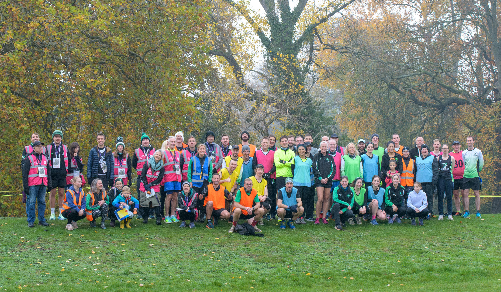

A superb race report from our very own Luke Hunter following CLC Striders Cheltenham parkrun takeover:

An explosion of green, black and white roared into Pittville Park on Saturday 7th November as CLC Striders - Cheltenham's most poppin' running club - hosted their latest parkrun volunteer headliner on a bonfire weekend to remember.

It was a quintessentially Autumn morning - grey and cold - but there is no greater crackle than the hubbub of a pre-run parkrun crowd on a Saturday morning to warm the bones. 702 parkrunners hovered around the start line - as a smokey fog lingered over the pristine lakes while Run Director Charlie Haward and CLC Chair Matt Ashman delivered a sparkling briefing.

With a whopping 24 pacers covering times from 17 to 40 minutes and no fewer than 20 marshals illuminating every corner of the two lap course, it was fair to say the team in green had delivered. parkrun is a key component in the week of a Strider and the burning passion by so many to be so visible today was testament to that.

The sizzling summer course is still hanging on with runners navigating booming cracks and fizzing-wet grass. A reminder of a hot summer past and a wild winter to come. Pittville is not an easy course at the best of times, but now it is at its most challenging and every single finisher today had a barrel full of perseverance.

A special mention to Steven Adams who completed a dazzling 500th finish while Amelia Mullins volunteered for a thunderous 50th time. Tourists joined us from Cornwall, Sheffield and Hackney and there were at least a couple of complete first timers who surely felt the spark from the glowing marshals.

It was fireworks at the front with CLC's Richard Elsworthy first to finish in 17:42, the top 30 all clocked sub-20 and a huge number of runners lit-up the course with stunning PBs. Incredibly the whole field finished in less than an hour with Emma Abbey bringing in the tail at 57:55.

As the catalogue of firework-themed-words can quickly grow tiresome, I'll wrap up my race report without them and take a few paragraphs to talk about CLC Striders and what it does for me and many others.

Striders is an inclusive and competitive running club, based at CLC Health and Fitness Centre, we meet twice weekly and have teams and runners competing across various disciplines. The club is open to all and aims to inspire and motivate members to enjoy their running - the last of those statements is the most important.

I have been a Strider for over three years and it has made a huge difference to my running performance. The coached sessions are engaging and exciting - even on those nights when just being there is an achievement. Amongst a myriad of other opportunites and benefits, CLC provides the variety and the team to what can easily become a repetitive and isolating sport.

Alongside that, it is equally important for my mental well-being. Like parkrun, it is a place and an activity that I can rely on once or twice a week to provide somewhere fun where I can be present and focused. The endorphins of a good run kick much harder when they are shared with others. The community and social aspect - again, like parkrun - is what makes it so special.

Hopefully today has demonstrated what a friendly bunch we are. In those years, I have never had a single ill-experience with another Strider - every possible type of runner is represented at CLC and regardless of times, positions, paces or splits, everybody genuinely just wants to see everybody else do their best. I think we all need more of that. It is a very motivating and welcoming environment - come and give it a try!

