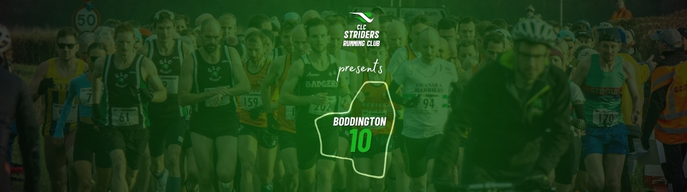
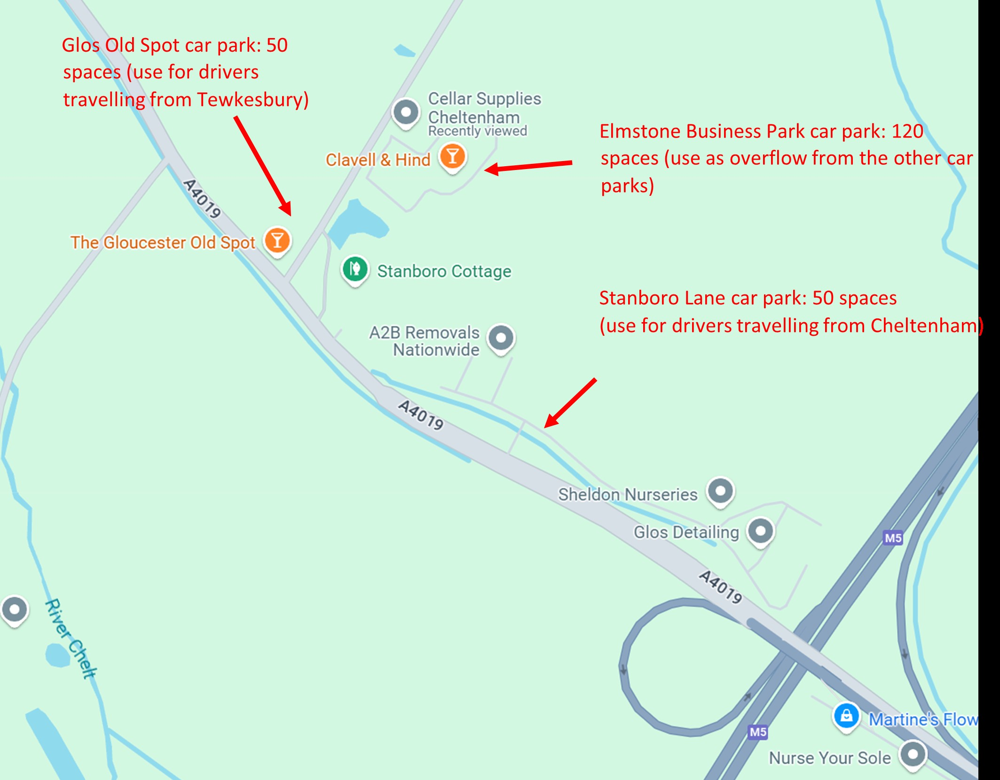

---

layout: default
title: Boddington 10
description: CLC Striders Boddington 10 mile race - information and results page
permalink: /boddington-10
signUpUrl : https://www.entrycentral.com/boddington-10
signUpYear: 2027
routeMap  : /assets/boddington/boddington-10-route-map.png
# open / full / closed / opensoon
state: full

---

 

[The {{ page.signUpYear }} Boddington 10 Race Entries are open, spaces are limited so sign up now!]({{ page.signUpUrl }})


 

Unfortunately places in the {{ page.signUpYear }} Boddington 10 have sold out! A waiting list can be joined via [Entry Central](https://www.entrycentral.com/boddington-10)


 

Entries for the Boddington 10 are currently closed.


 

Entries for the Boddington 10 will be available from 1200 on Sunday 15 November 2026 via Entry Central



---

##### Sunday 31 January 2027 | Race Start: 09:00

CLC Striders Running Club looks forward to welcoming you to the 2027 Boddington 10 Mile Road Race.

Established in 2024, the Boddington 10 has quickly become a popular fixture in the Gloucestershire road racing calendar. The event offers a flat, fast 10-mile course on quiet country roads, excellent race organisation, ample nearby parking, and a friendly atmosphere.

As an experienced race organiser, CLC Striders is committed to providing a safe, enjoyable and well-supported event for runners of all abilities. Please take a few minutes to read the information below to help ensure your race day runs smoothly.

#### Quick Reference Guide
 
* **Race Start:** 09:00 at the top of Boddington Lane.
* **Race HQ Opens:** 07:45.
* **UK Athletics Licence:** #31889.
* **Minimum Age:** 18 years on race day.
* **Race Number Collection:** Between 07:45 and 08:30.
* **Race Briefing:** 08:50 at the start line.
* **Headphones:** Personal listening devices are prohibited under UK Athletics rules, except approved bone-conducting headphones.
* **Parking:** Follow instructions from marshals at all times. Parking is limited, so please car share where possible.
* **Facilities:** Toilets will be available at The Gloucester Old Spot and Elmstone Business Park. There are no changing facilities.
* **Baggage Drop:** Available at Race HQ, but left entirely at the owner's risk. Do not leave valuables.
* **Unable to Run?** Please let us know as soon as possible so your place can be offered to someone on the waiting list.

--- 

#### Race HQ
 
Race Headquarters will be located outside The Gloucester Old Spot (postcode GL51 9SY).

CLC Striders volunteers will be available from 07:45 to assist runners with race-day enquiries.

---
 
#### Car Parking
 
Parking marshals will be on site from 07:45 to direct participants to the available parking areas.

We will be using:

* The Gloucester Old Spot car park
* The industrial estate further along the road
* A2B Removals on Stanboro Lane

To help manage demand, the first 50 vehicles arriving from Cheltenham will be directed to park on Stanboro Lane. This parking location is approximately 500 metres from Race HQ, with a footpath available for safe access.

##### Important Parking Information
* Please follow marshals' instructions at all times.
* Do not park on roads or verges under any circumstances.
* Allow extra time to walk from your allocated parking area, as some locations are up to 10 minutes from Race HQ.
* We **strongly encourage** car sharing where possible.

**Please note:** The Gloucester Old Spot car park must be vacated by 11:45 to accommodate regular customers, unless you are staying for lunch at the pub. Participants parked there should move their vehicles to the industrial estate after the race if planning to remain in the area.

---

#### Race number 

Race numbers and timing chips must be collected from Race HQ between 07:45 and 08:30.

Any runner who has not collected their number by 08:45 may have their place offered to someone from the waiting list who is ready to race.

When collecting your race number:

1. Complete the emergency information panel on the reverse, including:
* Name
* Emergency contact details
* Relevant medical information

2. Wear your race number clearly on the front of your vest throughout the race.

3. Attach your timing chip securely to your shoe laces. Instructions will be available at Race HQ.

Please note that results will be determined solely through chip timing. Runners who do not wear a timing chip will not receive an official result.

As a bonus, your race number entitles you to 15% off purchases at Up & Running for two weeks following race day.

---

#### Race information

The course will be fully marked with directional arrows, mile markers and staffed by CLC Striders marshals.

Please note that marshals cannot stop or direct traffic. Participants must remain alert and follow the Highway Code throughout the event.

##### Water Stations

A water station will be available in Barrow, accessible on each lap at approximately:

* 2 miles
* 4 miles
* 6 miles
* 8 miles

To help reduce waste, runners are encouraged to carry their own reusable bottles, which can be refilled at the water station.

##### Warm-Up Areas

For your safety, please use Boddington Lane for warm-up runs.

Do not warm up on:

* A4019 Tewkesbury Road
* The road passing Elmstone Business Park

Both roads carry significant traffic, including on Sunday mornings.

A designated route from Race HQ to the start line will be clearly signed, and a safe crossing point will be provided.

##### Headphones Policy

As this race is run under UK Athletics rules on open roads, personal listening devices are prohibited, with the exception of UKA-approved bone-conducting headphones.

Any participant found wearing prohibited headphones will be disqualified.

##### Course Description

The race follows a four-lap course.

Starting at the top of Boddington Lane, runners head towards Boddington before completing four laps of the Boddington and Barrow loop, finishing on Boddington Lane outside Robert Hitchings.

**Please note:** There is a short 200-metre out-and-back section on the first lap only.

The route will be fully signed and marshalled throughout.

As roads remain open to traffic, runners must keep to the left-hand side of the road at all times, unless directed otherwise by race officials. An application has been submitted to close the road for the duration of the race, an outcome is awaited.

##### Route Map
 
You will be able to review the route for the Boddington 10 race on [Strava](https://strava.app.link/kOtLaSvNyEb)
 
Route Map: [Map]({{ page.routeMap }})

##### Race start

* Race briefing: 08:50
* Race start: 09:00

The race will be run under UK Athletics rules.

##### Cut off time

To minimise disruption to local residents and ensure adequate marshal coverage throughout the event, a cut-off time of 2 hours will be enforced.

This equates to approximately:

* 12:00 minutes per mile
* 7:27 minutes per kilometre

Runners who reach the final lap point (approximately 7.4 miles) and are not on pace to finish within two hours will be asked to withdraw from the race.

##### At the Finish
 
After crossing the finish line:

1. Avoid distracting the race timekeepers while results are being recorded.
2. If you retire from the race, report to a race official immediately.
3. Collect water and move away from the finish area as soon as possible to allow space for other finishers.

Please then make your way back to Race HQ.

##### Post race

Please join us at the Clavell & Hind Brewery Tap for prize giving at 11:15.

All competitors will receive a complimentary drink.

Both The Gloucester Old Spot and Clavell & Hind Brewery Tap will be open after the race for food and refreshments. We encourage runners to support these local businesses, whose support helps make the event possible.

If you plan to eat at The Gloucester Old Spot, advance booking is recommended.

--- 

##### Prizes 

Prizes will be awarded for the 1st, 2nd and 3rd placed men and women and the 1st placed men and women in the following age categories:  MV40, MV45, MV50, MV55, MV60, MV65, MV70, MV75, LV35, LV40, LV45, LV50, LV55, LV60, LV65, LV70, LV75.

This year, we will also be offering a team prize. This will be awarded to the best placed UKA affiliated club consisting of 2 men and 2 women.

###### Prize structure

Up & Running vouchers will be awarded as follows:

* 1st place - Male & Female = £60
* 2nd place - Male & Female = £40
* 3rd place - Male & Female = £25
* Age category win = £20
* Course record bonus = £40
  
* Team prize = 4 bottles of wine

--- 

#### Results
 
As long as there is a good signal at Race HQ, live results will be available via [Lush timing](https://www.arrowliveresults.com/Boddington10Mile).
 
Soon after the race, we will post them on the [CLC Striders website](https://clcstriders-runningclub.co.uk).

--- 

#### Event Cancellation
 
While we hope to welcome you to the start line, participant safety will always be our priority. If severe weather or any other circumstances force us to cancel the event, we will contact all registered entrants by email and post updates on our [Facebook page](https://www.facebook.com/CLCStriders/). 

Please check your email regularly in the days leading up to the event and follow our social media channels for the latest race information.
 
#### Official race photos
 
Dig Deep Race Photography will be taking official race photos during the event. They will be available via their [website](https://linktr.ee/digdeepracephotography).

[2024 race photos](https://photos.app.goo.gl/c2kJ9p1RtZAPbg8SA)

[2025 race photos](https://photos.app.goo.gl/JbA4qZ3AspL2UBnf7)

[2026 race photos](https://photos.app.goo.gl/eVvDcv7hMWnfahLe6)

---
 
#### Course Records
 
Men's – Dom James, Western Tempo (2026) - 49:29
 
Women's – Alice Tredgett, Severn AC (2026) - 1:00:22
 
#### Previous results
 
The [2024 Boddington 10 results](/assets/boddington/2024-01-28-Boddington-10-results-2024.pdf "Boddington 10 results 2024").

The [2025 Boddington 10 results](/assets/boddington/2025-01-27-Boddington-10-results-2025.pdf "Boddington 10 results 2025").

The [2026 Boddington 10 results](https://results.raceroster.com/v3/events/jqapef375b47t4d7/race/250695)

---
 
#### Acknowledgements
 
* [A2B Removals Nationwide Limited](https://www.a2bmoving.com/) - for allowing us to use their yard for car parking.

* Boddington Estates Ltd, Cheltenham - For agreeing to adjust their animal feeding schedule to accommodate the race.

* [Clavell and Hind](https://www.clavellandhind.co.uk/), [Cellar Supplies](http://www.cellarsupplies.co.uk/), [In2Print](http://www.in2print.com/), [Journey Hospitality](https://journey.travel/) and [Phoenix Mechanical Engineers](http://www.phoenixmechanical.co.uk/) for providing parking.

* [CLC Health & Fitness Centre](https://fitness.cheltladiescollege.org/) - Friends and members of CLC Striders.

* [Robert Hitchins](https://www.robert-hitchins.co.uk/) – For allowing use of their property entrance for the race finish.

* [The Gloucester Old Spot](https://www.thegloucesteroldspot.co.uk/), Cheltenham – For providing our Race HQ and parking.

* [Up and Running](https://www.upandrunning.co.uk/) Cheltenham – for providing the race numbers.
