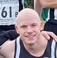
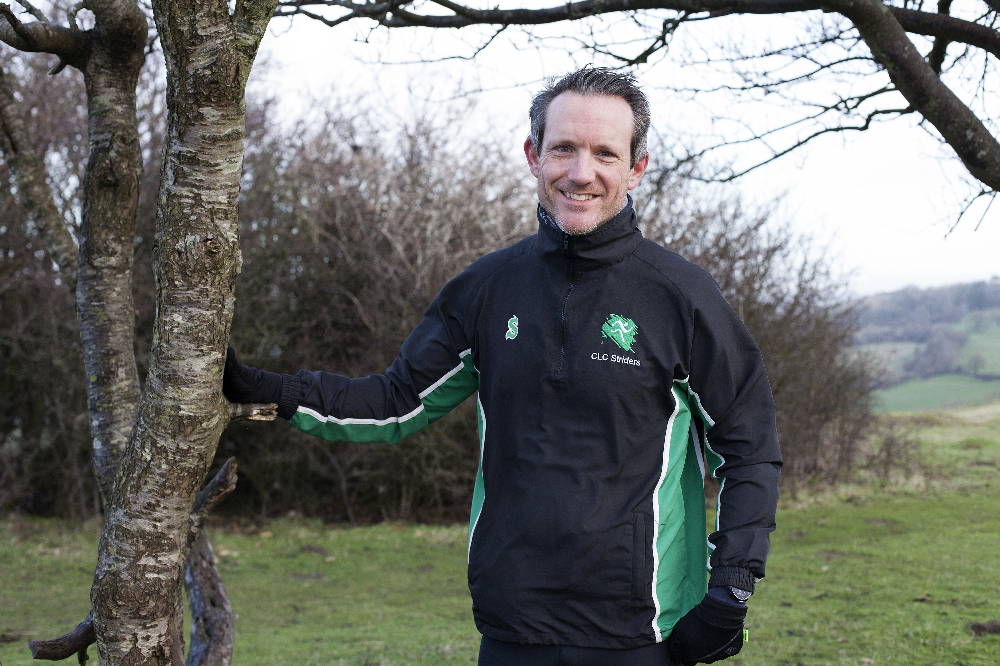
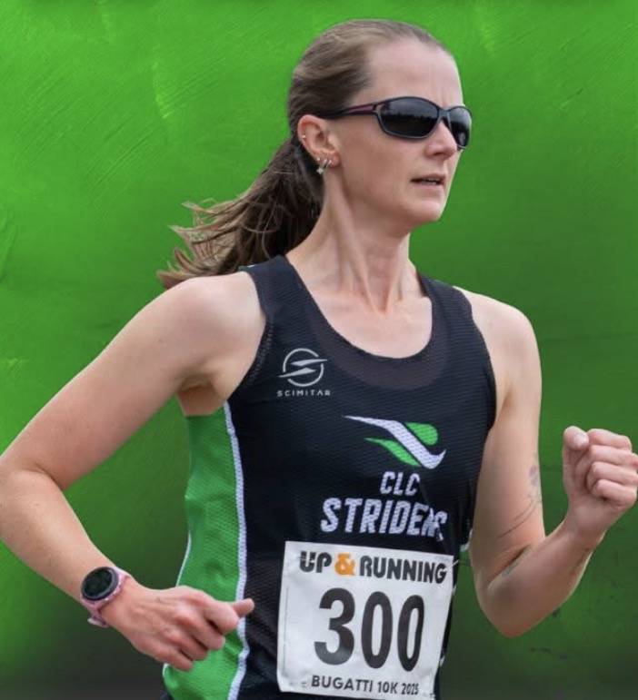

Whether you're fairly new to running, trying out a club for the first time or an experienced athlete chasing PBs, our training has something for you. We cater for a range of paces, so if you can run 4 miles (6.4km) in around 36 minutes or less, come and give us a try.

All our sessions are free for members, and you're welcome to try a few before you join. Members also receive a weekly email with details of the planned sessions. For more information, or to let us know you're coming along for the first time, email <training@clcstriders-runningclub.co.uk>.

**Where we meet:** [CLC Health & Fitness Centre]({{ site.mapUrl_CLC }}), Malvern Road, on the paved area just inside the main gate. There's free parking behind the centre, and toilets inside (just tell reception you're with the running club).

#### Mondays – Social run

Meet at 6.30pm, CLC Health & Fitness Centre

A sociable 4 or 6 mile run in groups of different paces, each with an experienced leader, starting and finishing at the centre. In winter we stick to well-lit pavements around Cheltenham; in summer we head to Pittville Park and the Racecourse.

##### Current Monday routes:
- Warden Hill & Hatherley
  - 4M / 6km - [OnTheGoMap](https://onthegomap.com/s/ln2hteio)
 <iframe width="425" height="350" frameborder="0" scrolling="no" marginheight="0" marginwidth="0" src="https://onthegomap.com/?m=r&amp;u=mi&amp;w%5B%5D=Routes+may+not+be+suitable+for+public+use.&amp;c%5B%5D=Route+data+%C2%A92026+On+The+Go+Map%2C+OpenStreetMap+Contributors&amp;d=6637&amp;f=d038d97537&amp;n=1&amp;dm=1&amp;context=embed&amp;r2=wruy9nfuC9GVq1HSX1s1d1W2x1u1d4r552D8j3u1z3Y2p3w1541020JPFHFDVNPPTRLL75X1VTN95f2d1H1P8B85EBF7373F3X13R3T22F0b18~1Qx2BJFH3DJ31r111FB75d1X175t1r19BDR9T5LNp3f1n67d1t1p3X2l3Tb1Z1X2x1t4t1X4v1l45NF451B5HDr1t1JLh1h1BDBDFHn1f1~2b2r1d1NFPTPX1FJb1r1z2Z4BHZ1r1Vt1Rz1Z5nDRj2f1r3Lz1DTr3b8x1b47Dr1l31020o1h2Y1j1s1f2w2n4CLUb2Kv1Et18TMh3Ud3k1n3Y1z28RAt12T2p1193z1Hv27x11X20Z14t1AX26TIz1CX1Of2Qh2Il17586o2k2MKW1c1o1u1SW1g1s1KQk2w2QSg1i2Us1Ga1Y1s2o1q4AQAUQa26EAIY1q1e3e48A44OY1Ok1OW2Ag1As14_12q2260U0Y10E1Y53Y37Y37e2Tu70CP_5Da43_10e12q11SAE4a1Ag10G26O1m2E60W4Mq18_3Qm6c1c3I602ACE2I3s162J_51AG8Rw8Bm39o21QJo5X1y9Rc8b2WL1E4M0O0Q4EGICKPy27W20c11GU1S4Y14G48484CG6DC7Q7I2g2e1A6UOY1W18668GEUSQQW1OGEGIKQ63q3v1_3X2k3t1K9e4s5y1t1e1~1Y1r1IRW1p147"></iframe> 
    
  - 6M / 10km - [OnTheGoMap](https://onthegomap.com/s/dv1cilg7) 
<iframe width="425" height="350" frameborder="0" scrolling="no" marginheight="0" marginwidth="0" src="https://onthegomap.com/?m=r&amp;u=km&amp;w%5B%5D=Routes+may+not+be+suitable+for+public+use.&amp;c%5B%5D=Route+data+%C2%A92026+On+The+Go+Map%2C+OpenStreetMap+Contributors&amp;d=10067&amp;f=d038d97537&amp;n=1&amp;dm=1&amp;context=embed&amp;r2=iruy9ffuC48Vq1HSX1s1d1W2x1u1d4r5JAj3u1z3Y2p3w15433FLFHFDVNPPTRLL75X1VTN95f2d1H1P8B85EBF7373F3X13R3T22F0b18~1Qx2BJFH3DJ31r1HD75d1X175t1r19BDR9T5LNp3Fj2PZ47d1t1p3X2l3Tb1Z1X2x1t4t1X4v1l45NF451B5HDr1t1JLh1h1BDBDFHn1f1~2b2r1d1NFPTPX1FJb1r1z2Z4BHZ1r1Vt1Rz1Z5nDRj2Tt2BTLz1DTr3b8x1b47Dr1l332x1i2d1q114j1a2X2q2x2y3HQIw1Qs26K1CDW19Oj6mFDW17Kf4iAFe1Hc1BMRe1~5k7Rg1Pi1Jk1Nw1Nm1HU5MJY17BHRf3p5x3n6d1X27BNd1Rt1Hp1Hr1Df22F0h1Cv1o5z98Bo1d3e1v2a1r2c1b3Cj1s1b6A~2096FGn1CRo2zEI~2W1r4c1p4k2j8Qt227m1j4O~1Y3f7c1j3Y1b3Uj3Mx2Kb3Qh48p18n1Ev28h1Ex2Ah1Cf1Ch1Gf1Gd1Ib1IZ1MZ1MVk1r1q1h1QJODm1JO7e13K5E7G7QRA0g1a1AI8EY1c3W1g3MY28GEUEy14k10k23s15o1041O5e20g22G2O6KCKIMOEQAq1SG8EEo2k2o2k2MKW1c1o1u1SW1g1s1KQk2w2QSg1i2Us1Ga1Y1s2o1q4AQAUQa26EAIY1q1e3e48A44OY1Ok1OW2Ag1As14_12q2260U0Y10E1Y53Y37Y37e2Tu70CP_5Da43_10e12q11SAE4a1Ag12M60I1m2E60W4Mq18_3Qm6c1i3IG4A27y2J_51AG8Rw8Bm39o21QJo5X1y9Rc8b2WL1E4M0O0Q4EGICKPy27W20c11G1e34q14u1Og5Iq3k1a9Uk5S_4F6Qc3482413K041E982Ud187i1f2ANKn1En16X1Ab26f22R0304Y4t1k2Z1o2Z1SBa1FO9g1JA3a2X1SJADw2p4CR6FOX2y1t1e1~1Y1r1IRSj1"></iframe> 
    
We change the route every few weeks. Other routes we use include:

- Benhall & Warden Hill
  - 4M - [Gmap](https://www.gmap-pedometer.com/?r=7304693) / GPX
  - 6M - [Gmap](https://www.gmap-pedometer.com/?r=7305262) / GPX

- Christmas lights
  - 4M - [Gmap](https://www.gmap-pedometer.com/?r=7428607) / GPX
  - 6M - [Gmap](https://www.gmap-pedometer.com/?r=7428605) / [GPX](assets/gpx/6m_Christmas_Lights.gpx)

- Honeybourne & Hewlett Rd / Hales Road
  - 4M / 6km - [OnTheGoMap](https://onthegomap.com/s/vuj0q5ek)
  - 6M / 10km - [OnTheGoMap](https://onthegomap.com/s/9797pm8f)
  
- Fiddler's Green & Benhall
  - 4M - [Gmap](http://www.gmap-pedometer.com/?r=7749814) / GPX
  - 6M - [Gmap](http://www.gmap-pedometer.com/?r=7749815) / GPX

- Summer route with Pittville Park / Racecourse
  - 4M - [Gmap](https://www.gmap-pedometer.com/?r=7752456) / GPX
  - 6M - [Gmap](https://www.gmap-pedometer.com/?r=6584229) / [GPX](assets/gpx/6m_Summer_Route_Pittville_Park_Racecourse.gpx)
  - 8M - Gmap / [GPX](assets/gpx/8m_Summer_Route_Pittville_Park_Racecourse.gpx)

- Warden Hill & Hatherley
  - 4M - [Gmap](https://www.gmap-pedometer.com/?r=6085072) / [GPX](assets/gpx/4m_Warden_Hill_Hatherley.gpx)
  - 6M - [Gmap](https://www.gmap-pedometer.com/?r=6085063) / [GPX](assets/gpx/6m_Warden_Hill_Hatherley.gpx)

#### Wednesdays – Interval sessions

Meet at 6.30pm, CLC Health & Fitness Centre

Led by our qualified coaches, these sessions are brilliant for building fitness, running efficiency, technique and pacing. Everyone works at their own pace and sessions are structured so no-one gets left behind; depending on numbers and conditions, we may split into two pace groups. In winter we train on the Honeybourne Line (tarmac, well-lit and traffic-free); in summer we use the grass track and sports field at the CLC and Pittville Park.

##### Track sessions – Prince of Wales Stadium

Wednesdays, 8pm–9pm, [Prince of Wales Stadium]({{ site.mapUrl_POW }}) – free

Join us on the track for an hour long session of distance based intervals

We run two blocks a year:
- **Spring:** 10 weeks, starting the first week of March
- **Autumn:** 10–20 weeks, starting in September

#### Tips for club runs

To keep club runs safe and enjoyable for everyone:

- Dress for the weather – we run in heat, cold and rain
- In the dark, wear reflective clothing and ideally lights
- Take care crossing roads and on uneven ground
- On Monday runs, stay with your group and follow your leader; if the pace doesn't suit, try a different group next week
- Don't leave anyone behind at the back of the group
- Tell your group leader if you're running straight home rather than back to the centre
- Speak to a coach or group leader about any injuries or concerns, before, during or after a run
- We welcome your ideas and suggestions, so let us know what you think!

#### Meet Our Coaches

Our coaches hold England Athletics' Coach in Running Fitness (CiRF) qualification and are DBS-checked. Talk to them about your training goals, any running questions or concerns.

&emsp;&emsp;**Matt Ashman**  
&emsp;&emsp;
- Joined CLC Striders in 2019, CiRF since 2022

&emsp;&emsp;**Joel Freeland**  
&emsp;&emsp;
- Joined CLC Striders in 2010, CiRF since 2017

&emsp;&emsp;**Jamie Hartnoll**  
&emsp;&emsp;
- Joined CLC Striders in 2022, CiRF since 2023

&emsp;&emsp;**Jon Howes**  
&emsp;&emsp;
- Joined CLC Striders in 2009, CiRF since 2025

&emsp;&emsp;**Amelia Mullins**  
&emsp;&emsp;
- Joined CLC Striders in 2009, CiRF since 2019
- Co-ordinator of Monday night club runs

&emsp;&emsp;**Kate Telford**  
&emsp;&emsp;
- Joined CLC Striders in 2020, CiRF since 2026
   

##### Run Leaders

Our run leaders hold England Athletics' Leadership in Running Fitness (LiRF) qualification and are DBS-checked.

- Andy Brookes
- Eoin McQuone
- Helen Rawcliffe
- Laura Elsworthy
- Nick Ledwold
- Nicola Weager
- Paul Northup
- Rich Elsworthy
- Steph Parker
- Tim Brock
